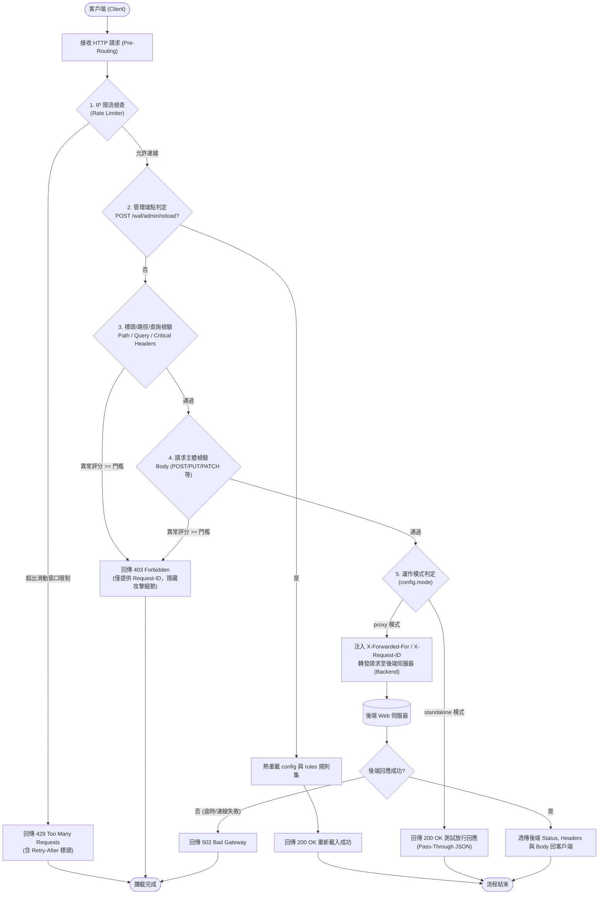

# Web Application Firewall (WAF) 企業級應用層防火牆核心

這是一個以 **C++20** 開發的高效能 Layer 7（應用層）網站應用程式防火牆（Web Application Firewall, WAF）。本專案專為防禦現代 Web 應用常見漏洞設計，具備**多輪遞迴解碼正規化**、**異常評分決策體系 (Anomaly Scoring)**、**語法上下文精確比對（防誤判機制）**、**零資訊洩漏防護 (Zero Information Disclosure)**、**IP 滑動窗口頻率限制 (Rate Limiting)**、**真實反向代理轉發 (Reverse Proxy)** 與 **線上零中斷規則動態熱重載 (Dynamic Hot-Reload)** 等企業級防護機制。

---

## 目錄

- [專案架構說明](#專案架構說明)
- [核心架構與處理流程](#核心架構與處理流程)
- [核心功能升級與缺陷修復對照表](#核心功能升級與缺陷修復對照表)
- [安全防護規則庫與偵測範圍](#安全防護規則庫與偵測範圍)
- [設定檔格式與參數詳解](#設定檔格式與參數詳解)
  - [系統設定檔 (`config/waf_config.json`)](#系統設定檔-configwaf_configjson)
  - [外部規則檔 (`config/waf_rules.json`)](#外部規則檔-configwaf_rulesjson)
- [API 回應規範與狀態碼](#api-回應規範與狀態碼)
- [環境需求](#環境需求)
- [編譯與建置指引](#編譯與建置指引)
  - [方法一：VS Code 一鍵編譯與除錯](#方法一vs-code-一鍵編譯與除錯)
  - [方法二：CMake 標準建置](#方法二cmake-標準建置)
  - [方法三：g++ / MinGW-w64 命令列直接編譯](#方法三g--mingw-w64-命令列直接編譯)
- [啟動與運作模式](#啟動與運作模式)
- [自動化測試與驗證](#自動化測試與驗證)
  - [1. 核心安全防護與抗誤判測試 (`test_waf.py`)](#1-核心安全防護與抗誤判測試-test_wafpy)
  - [2. 反向代理轉發與後端聯防測試 (`test_proxy.py`)](#2-反向代理轉發與後端聯防測試-test_proxypy)

---

## 專案架構說明

```text
.
├── .vscode/
│   ├── c_cpp_properties.json    # VS Code C++ IntelliSense 與標頭檔路徑設定
│   ├── launch.json              # 一鍵除錯與執行設定 (F5 快捷鍵)
│   └── tasks.json               # 一鍵編譯建置工作 (Ctrl + Shift + B 快捷鍵)
├── config/
│   ├── waf_config.json          # WAF 核心設定檔 (監聽埠口、模式、代理目標、限流與門檻)
│   └── waf_rules.json           # 外部動態自訂安全規則集 (JSON 格式，支援熱重載)
├── include/
│   ├── config.hpp               # 系統組態結構定義與 JSON 讀取器標頭
│   ├── httplib.h                # 輕量級高效能 HTTP 伺服器與客戶端庫 (yhirose/cpp-httplib)
│   ├── json.hpp                 # Modern C++ JSON 解析函式庫 (nlohmann/json)
│   ├── proxy_handler.hpp        # 反向代理轉發器、標頭注入與後端通訊定義
│   ├── rate_limiter.hpp         # 執行緒安全 IP 滑動窗口頻率限制器標頭
│   ├── rule_engine.hpp          # 規則比對引擎、異常評分決策與檢測結果結構
│   └── url_utils.hpp            # 多輪遞迴解碼、HTML Entity 還原與路徑正規化工具
├── src/
│   ├── config.cpp               # 設定檔讀取、安全預設產生與解析實作
│   ├── main.cpp                 # WAF 主程式進入點 (Pre-Routing 排程、審計日誌與方法路由)
│   ├── proxy_handler.cpp        # 反向代理 Request 轉發、標頭注入與 Response 透傳實作
│   ├── rate_limiter.cpp         # 多執行緒 IP 滑動窗口限流與定時自動過期清理實作
│   ├── rule_engine.cpp          # 預設規則庫初始化、外部 JSON 載入與多層次檢驗實作
│   └── url_utils.cpp            # 多層 URL 解碼、HTML Entity 轉換、Null Byte 剝除與斜線規範化
├── tests/
│   ├── test_waf.py              # 全功能自動化驗證套件 (正常請求、防誤判、SQLi/XSS/目錄遍歷/指令注入/熱重載/429 限流)
│   └── test_proxy.py            # 反向代理轉發、真實後端聯防、標頭透傳與惡意請求阻斷驗證腳本
├── CMakeLists.txt               # 跨平台 CMake 建置組態檔
├── waf.exe                      # 已編譯之 WAF 核心二進位執行檔
├── .gitignore                   # Git 版本控制忽略設定檔
└── README.md                    # 專案技術文件與使用指南
```

---

## 核心架構與處理流程

當外部 HTTP 請求進入 WAF 核心時，將依序經過多道防線的檢查與過濾：



---

## 核心功能升級與缺陷修復對照表

本版本針對傳統 WAF 常見缺陷進行了全面重構與修正，具體成果如下：

| 防護項目 / 功能領域 | 舊版設計缺陷 | 新版實作升級與技術方案 |
| :--- | :--- | :--- |
| **編碼逃逸繞過** | 僅實施單次 URL 解碼，易受 `%252e%252e%252f`（雙重編碼）逃逸 | **多輪遞迴 URL 解碼**（上限 5 輪）、**HTML Entity 數值與具名實體還原**（如 `&#60;`、`&lt;`）、**Null Byte 剝除 (`\0`)** 與 **路徑斜線規範化**。 |
| **常態誤判 (False Positive)** | 規則過於嚴苛（例如只要偵測到 `#` 或 `--` 即阻擋，造成 `C#`、`#ffffff`、`step--1` 遭誤殺） | **語法上下文嚴格判定**（註解需配合空白、換行或引號），並導入 **異常評分體系 (Anomaly Scoring)**，權重累計達標才進行阻斷。 |
| **敏感防禦資訊洩漏** | 403 阻擋回應外洩內部觸發之規則名稱、規則 ID 與比對到之 Payload 特徵 | **零資訊洩漏 (Zero Information Disclosure)**：對客戶端僅回傳統一安全的錯誤 JSON 與唯一 `Request-ID`，內部終端則保留 ANSI 彩色即時審計日誌。 |
| **反向代理能力** | 僅支援靜態模擬回應 (Mock)，無法部署於真實業務伺服器前 | 支援原生 **`proxy` 反向代理模式**，完整透傳 Request 與 Response，自動注入 `X-Forwarded-For`、`X-Forwarded-Proto`、`X-Real-IP`、`X-Request-ID`。 |
| **高頻請求與 DoS 防範** | 缺乏頻率控制，無法抵抗暴力破解、惡意爬蟲或高頻洪水攻擊 | 內建執行緒安全 **IP 滑動窗口限流器 (Rate Limiter)**，可自訂時間窗口與請求次數，超標時回傳 HTTP 429 及 `Retry-After`。 |
| **規則維運中斷問題** | 規則完全硬編碼在 C++ 原始碼中，新增或微調特徵需重新編譯整組程式 | 抽離規則至外部 `config/waf_rules.json`，並提供 **`POST /waf/admin/reload` 熱重載端點**，免重啟服務即可線上套用新規則。 |
| **HTTP 協定覆蓋度** | 僅能攔截 GET / POST，其他 HTTP 動詞繞過防線 | 完整涵蓋 **GET, POST, PUT, DELETE, PATCH, OPTIONS, HEAD**，並支援 Request Body 的深度 Payload 檢驗。 |

---

## 安全防護規則庫與偵測範圍

WAF 規則引擎針對 OWASP Top 10 常見攻擊構建了高精準度特徵庫：

### 1. SQL 注入防護 (SQL Injection - SQLi)
* **聯合查詢 (UNION SELECT)**（ID: `942100`，權重: 5）：阻斷 `UNION [ALL] SELECT` 跨表查詢。
* **恆真式與布林盲注**（ID: `942110`，權重: 5）：阻斷 `' OR '1'='1`、`' OR true`、`AND 'a'='a'` 等繞過驗證邏輯。
* **時間盲注與資料庫特定函數**（ID: `942120`，權重: 5）：偵測 `sleep()`、`benchmark()`、`waitfor delay`、`extractvalue()`、`updatexml()` 等函式呼叫。
* **堆疊指令注入 (Stacked Queries)**（ID: `942130`，權重: 5）：阻斷以分號結尾並串接 `DROP`、`INSERT`、`UPDATE`、`DELETE`、`CREATE` 等 DDL/DML 語句。
* **SQL 註解注入**（ID: `942140`，權重: 3）：安全識別 `-- `、`/*...*/`、`'#`、`;#`，精準放行 C#、色碼等合法字串。

### 2. 跨站腳本防護 (Cross-Site Scripting - XSS)
* **危險 HTML 標籤**（ID: `941100`，權重: 5）：偵測 `<script>`、`<iframe>`、`<object>`、`<embed>`、`<svg>`、`<style>`、`<meta>`、`<link>` 等標籤。
* **DOM 事件處理器 (Event Handlers)**（ID: `941110`，權重: 5）：防禦 `onerror=`、`onload=`、`onclick=`、`ontoggle=` 等所有 `on*=` 屬性。
* **偽協議 (Pseudo-Protocols)**（ID: `941120`，權重: 5）：阻斷 `javascript:`、`data:`、`vbscript:` 等位址協議。
* **危險 JS 執行函式與物件存取**（ID: `941130`，權重: 5）：阻斷 `alert()`、`prompt()`、`eval()`、`document.cookie`、`window.location` 等敏感操作。

### 3. 路徑穿越防護 (Path Traversal / Local File Inclusion)
* **目錄遍歷與跳脫點號**（ID: `930100`，權重: 5）：阻斷 `../`、`..\`、`..;`、多層雙重 URL 編碼（如 `%252e%252e%252f`）逃逸。
* **敏感核心系統檔案存取**（ID: `930110`，權重: 5）：攔截針對 `/etc/passwd`、`/etc/shadow`、`hosts`、`windows/system32`、`win.ini`、`boot.ini` 的讀取企圖。

### 4. 系統指令注入防護 (Command Injection)
* **指令串接運算子**（ID: `932100`，權重: 5）：阻斷透過 `&&`、`||`、`;`、`|`、反引號 ` ` ` 或 `$()` 串接 `cat`、`whoami`、`id`、`powershell`、`curl`、`wget`、`nc` 等系統指令。
* **換行符號指令注入**（ID: `932110`，權重: 5）：阻斷利用 `\r`、`\n` 分隔並執行未授權系統指令。

---

## 設定檔格式與參數詳解

### 系統設定檔 (`config/waf_config.json`)

```json
{
    "server": {
        "host": "0.0.0.0",
        "port": 8080,
        "mode": "standalone"
    },
    "backend": {
        "host": "127.0.0.1",
        "port": 3000
    },
    "security": {
        "anomaly_threshold": 5,
        "custom_rules_file": "config/waf_rules.json"
    },
    "rate_limit": {
        "enabled": true,
        "max_requests": 30,
        "window_seconds": 10
    }
}
```

#### 欄位說明：
* **`server.host`** *(string)*：WAF 服務綁定 IP（`0.0.0.0` 代表監聽所有網路介面）。
* **`server.port`** *(int)*：WAF 監聽埠號（預設為 `8080`）。
* **`server.mode`** *(string)*：
  * `"standalone"`：單機獨立測試模式，合法請求直接回傳 200 OK 模擬回應。
  * `"proxy"`：反向代理模式，合法請求將轉發至後端伺服器並回傳後端內容。
* **`backend.host`** *(string)*：後端 Web 伺服器 IP（`proxy` 模式專用）。
* **`backend.port`** *(int)*：後端 Web 伺服器連接埠（`proxy` 模式專用）。
* **`security.anomaly_threshold`** *(int)*：異常評分阻擋門檻（預設為 `5`，當單一請求累計威脅分數 >= 此門檻時觸發 403 阻擋）。
* **`security.custom_rules_file`** *(string)*：外部動態規則定義檔路徑。
* **`rate_limit.enabled`** *(bool)*：是否啟用 IP 滑動窗口限流防禦（`true` / `false`）。
* **`rate_limit.max_requests`** *(int)*：滑動窗口時間內允許單一 IP 發出的最大請求上限。
* **`rate_limit.window_seconds`** *(int)*：滑動時間窗口長度（單位：秒）。

---

### 外部規則檔 (`config/waf_rules.json`)

規則檔採用 JSON 陣列結構，支援管理員依業務需求自訂正規表示式與評分權重：

```json
[
    {
        "id": "942100",
        "attack_type": "SQLi",
        "rule_name": "SQLi-Union-Select",
        "pattern": "\\bunion\\b\\s+(\\ball\\b\\s+)?\\bselect\\b",
        "score": 5
    },
    {
        "id": "941100",
        "attack_type": "XSS",
        "rule_name": "XSS-Dangerous-Tags",
        "pattern": "<\\s*(script|iframe|object|embed|svg|style|meta|link|base)\\b[^>]*>?",
        "score": 5
    }
]
```

* **`id`**：規則唯一代碼。
* **`attack_type`**：攻擊類別（如 `SQLi`、`XSS`、`PathTraversal`、`CmdInjection`）。
* **`rule_name`**：規則名稱。
* **`pattern`**：PCRE 相容正規表示式字串（請注意 JSON 跳脫字元 `\\`）。
* **`score`**：威脅權重值（一般高危險攻擊設定為 5，疑似特徵設定為 3）。

---

## API 回應規範與狀態碼

系統對於不同情境的回應格式均有標準化規範：

### 1. 合法請求放行 (`200 OK`)
* **Standalone 模式**：
  ```json
  {
    "status": 200,
    "message": "恭喜！請求通過 WAF 防火牆檢驗 (Pass-Through)",
    "method": "GET",
    "path": "/products",
    "request_id": "req-1730000000000-1001"
  }
  ```
* **Proxy 模式**：原生透傳後端伺服器之 HTTP 狀態碼、Headers 與 Response Body，並額外附帶 `X-Request-ID`。

### 2. 管理熱重載端點 (`200 OK`)
* **端點**：`POST /waf/admin/reload`
* **回應範例**：
  ```json
  {
    "status": 200,
    "message": "WAF 配置與規則庫已成功熱重載",
    "anomaly_threshold": 5,
    "mode": "proxy"
  }
  ```

### 3. 攻擊攔截回應 (`403 Forbidden` - 零資訊洩漏規範)
* **回應標頭**：`X-Request-ID: <唯一請求識別碼>`
* **回應內容**：
  ```json
  {
    "status": 403,
    "error": "Access Denied by WAF",
    "message": "您的請求違反安全策略已被攔截",
    "request_id": "req-1730000000000-1002"
  }
  ```
  > [!NOTE]
  > 對外客戶端回應僅包含追蹤用 `request_id`，絕不洩漏命中的內部規則名稱、正則表達式或 Payload 片段，避免攻擊者藉以探測調整攻擊手法。詳細攻擊來源 IP、觸發規則與惡意內容均即時記錄於伺服器內部終端機日誌。

### 4. 頻率限制超標 (`429 Too Many Requests`)
* **回應標頭**：`Retry-After: 10`、`X-Request-ID: <唯一請求識別碼>`
* **回應內容**：
  ```json
  {
    "status": 429,
    "error": "Too Many Requests",
    "message": "請求過於頻繁，已被防火牆限流攔截",
    "request_id": "req-1730000000000-1003"
  }
  ```

### 5. 後端連線異常 (`502 Bad Gateway`)
* **回應內容** (Proxy 模式下後端離線或逾時)：
  ```json
  {
    "status": 502,
    "error": "Bad Gateway",
    "message": "後端伺服器無回應或連線中斷",
    "request_id": "req-1730000000000-1004"
  }
  ```

---

## 環境需求

* **作業系統**：Windows 10 / 11、Windows Server（亦可移植至 Linux / macOS）
* **編譯器**：支援 C++20 標準之編譯器（GCC 11+ / MinGW-w64、Clang 13+ 或 MSVC 2019+）
* **網路通訊庫 (Windows)**：系統內建 Winsock2（`-lws2_32`）
* **建置工具（可選）**：CMake 3.20 或以上版本
* **測試執行環境**：Python 3.8 或以上版本（內建 `urllib`，無須額外安裝第三方 pip 套件）

---

## 編譯與建置指引

專案提供三種編譯方式，開發者可依使用習慣自由選擇：

### 方法一：VS Code 一鍵編譯與除錯
1. 在 VS Code 中開啟專案根目錄。
2. 按下快捷鍵 **`Ctrl + Shift + B`**：觸發預設建置任務，自動調用 g++ 編譯出 `waf.exe`。
3. 按下快捷鍵 **`F5`**：自動編譯並啟動除錯器（gdb.exe）執行 `waf.exe 8080`。

---

### 方法二：CMake 標準建置
```powershell
# 1. 產生建置配置檔
cmake -B build -DCMAKE_BUILD_TYPE=Release

# 2. 執行建置編譯
cmake --build build --config Release
```

---

### 方法三：g++ / MinGW-w64 命令列直接編譯
在 PowerShell 或 CMD 中切換至專案根目錄，執行以下指令：

```powershell
g++ -std=c++20 -D_WIN32_WINNT=0x0A00 -static -O2 -Iinclude src/main.cpp src/rule_engine.cpp src/url_utils.cpp src/config.cpp src/rate_limiter.cpp src/proxy_handler.cpp -lws2_32 -o waf.exe
```

---

## 啟動與運作模式

### 1. 依照設定檔預設啟動
```powershell
.\waf.exe
```
> [!NOTE]
> 若第一次執行且未偵測到 `config/waf_config.json`，WAF 將自動建立目錄並產生包含安全預設值的設定檔。

### 2. 透過命令列覆蓋埠號與運作模式
語法格式：`.\waf.exe [port] [mode]`

```powershell
# 以獨立單機模式監聽 8080 埠號
.\waf.exe 8080 standalone

# 以反向代理模式監聽 8080 埠號 (將流量轉發至後端)
.\waf.exe 8080 proxy
```

啟動後終端機將輸出運作狀態橫幅：
```text
======================================================
     [進階企業級 WAF 防火牆核心 (Enhanced WAF Core)]   
  - 運作模式: 單機獨立模式 (Standalone)
  - 監聽介面: 0.0.0.0:8080
  - 異常評分閥值 (Anomaly Threshold): 5
  - 頻率限制 (Rate Limiting): 已啟用 (30 reqs / 10s)
  - 雙重 URL 編碼與特殊字元規範化: 已啟用
  - 敏感特徵隱藏 (零資訊洩漏 403 回應): 已啟用
======================================================
```

---

## 自動化測試與驗證

專案內建完整的自動化驗證腳本，分為核心安全防禦測試與反向代理後端聯防測試兩大模組。

### 1. 核心安全防護與抗誤判測試 (`test_waf.py`)

在終端機中保持 WAF 於 8080 埠口執行，於另一個終端機輸入：

```powershell
py -u tests/test_waf.py
```

#### 驗證涵蓋項目（全數 22 項測試 + 頻率限制壓測）：
1. **合法請求放行（5 項）**：首頁 GET、多參數產品查詢、使用者登入表單 POST、個人資料 PUT、資源刪除 DELETE。
2. **防誤判檢驗（3 項）**：
   * 搜尋含 `#` 關鍵字（如 `q=C# programming`）正常放行（200 OK）。
   * POST 包含顏色十六進位碼（如 `{"color": "#ffffff"}`）正常放行（200 OK）。
   * 包含連續連字號之標籤（如 `name=step--1`）正常放行（200 OK）。
3. **SQL 注入攔截（4 項）**：萬能密碼注入、`UNION SELECT` 跨表查詢、`DROP TABLE` 堆疊指令、`sleep(5)` 時間盲注（全數 403 Forbidden）。
4. **跨站腳本 XSS 攔截（4 項）**：`<script>` 標籤、`<svg onload>` 標籤、`onerror=` 事件屬性、`javascript:` 偽協議（全數 403 Forbidden）。
5. **路徑穿越攔截（3 項）**：`../../etc/passwd`、雙重編碼 `%252e%252e%252f` 繞過逃逸、Windows `windows/system32` 核心路徑（全數 403 Forbidden）。
6. **系統指令注入攔截（2 項）**：分號串接 `; whoami`、邏輯運算子 `&& curl`（全數 403 Forbidden）。
7. **線上熱重載端點（1 項）**：`POST /waf/admin/reload`（200 OK）。
8. **零資訊外洩驗證**：自動驗證所有 403 阻擋回應中是否包含 `request_id`，並嚴格確認絕無洩漏任何內部正則規則特徵或 Payload。
9. **高頻連線限制測試 (Rate Limiting)**：連續發送高頻連線，驗證第 31 次連線精準觸發 HTTP 429 Too Many Requests。

---

### 2. 反向代理轉發與後端聯防測試 (`test_proxy.py`)

此腳本用於驗證 WAF 與真實 Web 伺服器之間的聯防工作：

```powershell
py -u tests/test_proxy.py
```

#### 驗證流程：
1. 自動於背景啟動 Python 輕量測試後端（監聽埠號 `3000`）。
2. 發送管理命令熱重載 WAF 轉為 `proxy` 模式（目標轉向 `127.0.0.1:3000`）。
3. 發送合法 GET 請求至 WAF，驗證請求被成功透傳至後端，且客戶端收到後端原生資料與標頭。
4. 檢驗後端伺服器接收到的標頭，確認 WAF 已成功注入 **`X-Forwarded-For: 127.0.0.1`** 與 **`X-Request-ID`**。
5. 發送 XSS 惡意攻擊請求至 WAF，驗證 WAF 立即給予 403 阻擋，**且後端完全未接收到任何惡意流量**。
6. 自動切回 `standalone` 模式完成測試閉環。

---

## 授權條款 (License)

本專案遵循 MIT License 授權開放。
